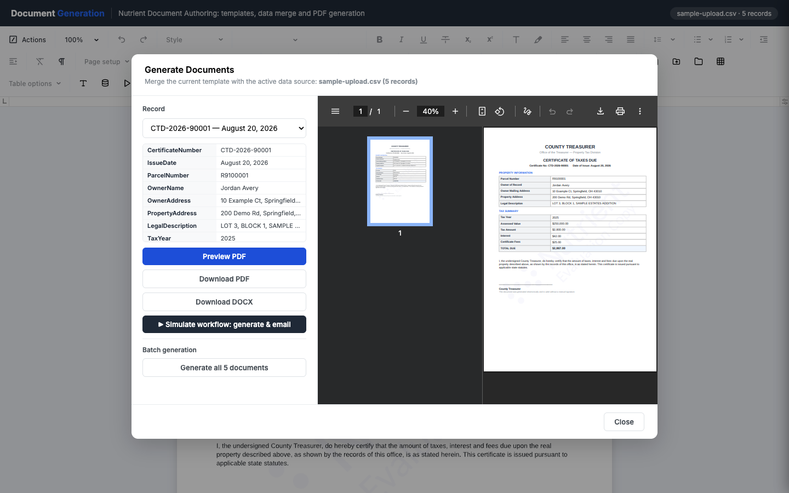
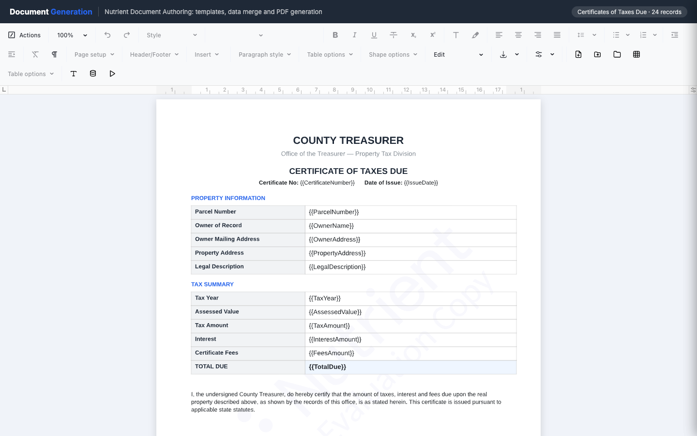
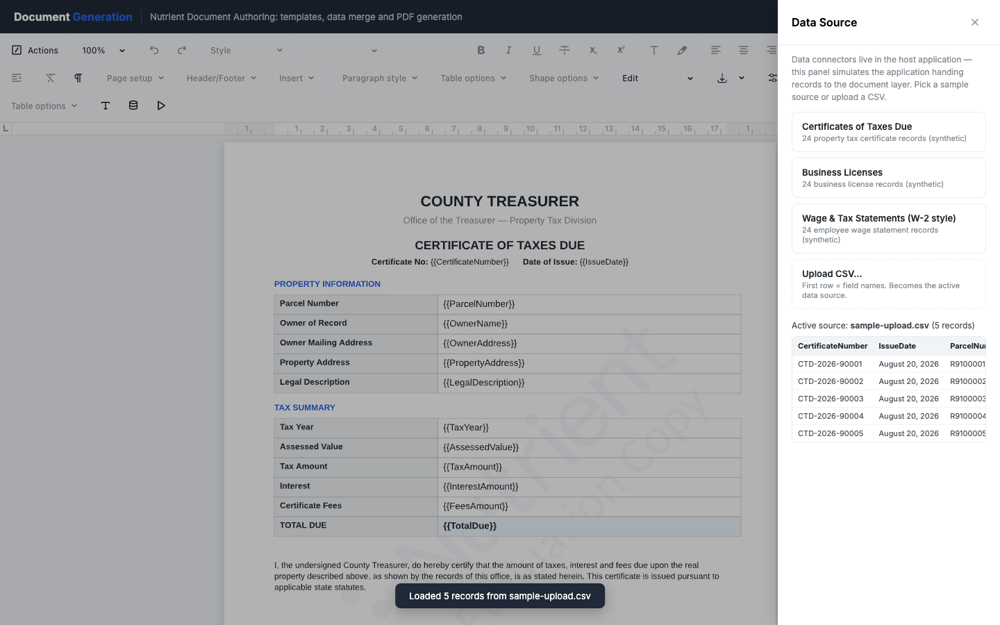

# Nutrient Document Generation

A Nutrient.io demo that merges records into a DOCX template with `{{fields}}` and renders one PDF per record, entirely in the browser.



1. **Template.** The app opens on a sample government form with `{{Field}}` placeholders. Three forms are included: a certificate of taxes due, a business license certificate and a W-2 style wage statement. They are built in the browser with the `docx` library (`src/templates.js`).
2. **Authoring.** The template opens in Nutrient Document Authoring, a Word-like editor that works natively on DOCX. You can change text, styles and tables, open your own DOCX or start from a blank document. **Insert Field** inserts a `{{Field}}` from the active data source at the cursor.
3. **Data.** Each template has a synthetic dataset of 24 records (`src/data.js`). You can also upload a CSV file; its first row holds the field names. In a real deployment the host application passes the records to the document layer. This panel only simulates that.
4. **Merge.** The current editor state is exported as DOCX. `src/merge.js` replaces every `{{Field}}` in the body, headers and footers at the OOXML level, including placeholders split across several runs.
5. **Render.** Document Authoring imports the merged DOCX and exports it to PDF with WebAssembly in the browser.
6. **Output.** Preview the PDF, download the PDF or the merged DOCX, step through a simulated workflow (business event, merge, render, email), or generate a PDF for every record and download them as a ZIP.

The **Custom Table** builder adds tables where each column has its own number of rows and row heights, with horizontal merges, borders per edge and cell colours. There is no server. The browser loads the Document Authoring engine and fonts from the Nutrient CDN.

## Prerequisites

- Node.js 20 or later and npm
- A recent Chromium, Firefox or Safari browser

## Environment variables

Copy `.env.example` to `.env`. Vite reads the file at dev and build time. Keys are never stored in code.

| Variable | Purpose | Default |
|---|---|---|
| `VITE_DOCAUTH_LICENSE_KEY` | Nutrient Document Authoring license key | empty = evaluation mode |

In evaluation mode, exported PDFs carry an "Evaluation Copy" watermark and the session expires after one hour. Reload the page to start a new session.

## Build and run

```bash
npm install
```

```bash
cp .env.example .env
```

```bash
npm run dev
```

Open the URL that Vite prints, <http://localhost:5173> by default.

```bash
npm run build
```

`npm run build` writes the static app to `dist/`. `npm run preview` serves it locally.

```bash
npm run samples
```

`npm run samples` writes `samples/sample-upload.csv`: five fictitious records whose columns match the certificate of taxes due template.

## Using the app

1. The app opens on the certificate of taxes due. The chip at the top right shows the active data source and its number of records.
2. Edit the template like in Word. **Samples** lists the three templates; picking one also selects its dataset. **New Document** starts from a blank page and **Open File…** opens a local DOCX.
3. Click in the document, open **Insert Field** and click a field. Each field shows a sample value from the active source.

   

4. Open **Data** and pick a dataset, or click **Upload CSV…** and choose `samples/sample-upload.csv`. The CSV becomes the active source.

   

5. Click **Generate**. Pick a record and click **Preview PDF**, **Download PDF** or **Download DOCX**.
6. **Simulate workflow: generate & email** shows the transactional flow: business event from the host application, merge, PDF rendering, email. The email is simulated and nothing is sent.
7. **Generate all N documents** renders every record to PDF, shows the total and average time per document, and downloads a ZIP.
8. **Custom Table** opens the table builder: set the columns, the rows and row heights of each column, then insert. Right-click in the document and choose **Advanced options** to merge or split cells and to set **Borders...** and **Colors...**.

Data connectors (CSV import, databases), single sign-on and email delivery belong to the host application and are not part of this demo.
